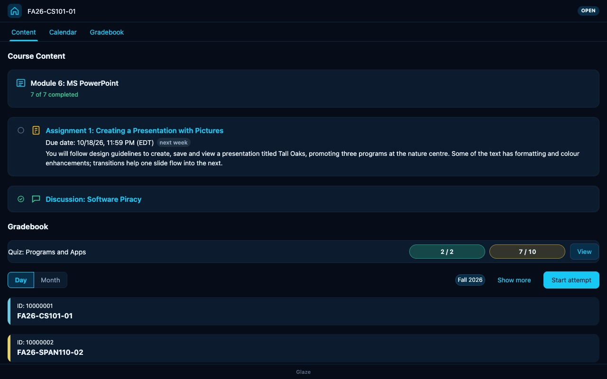
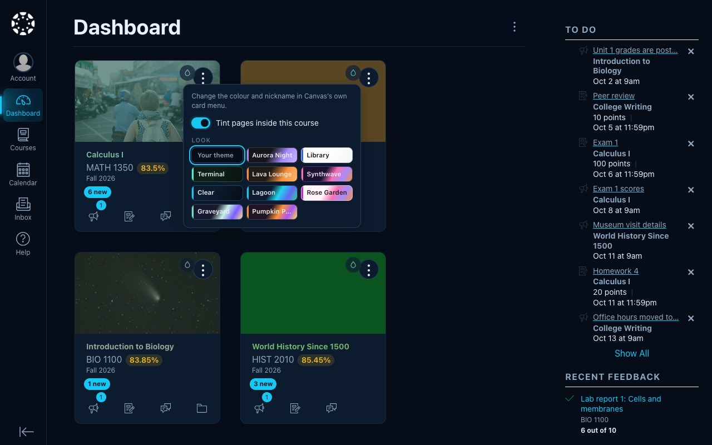
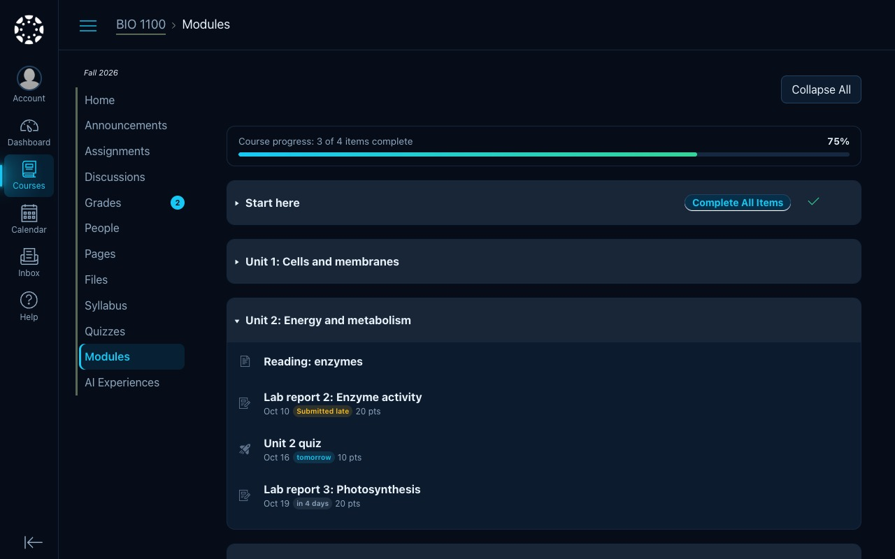
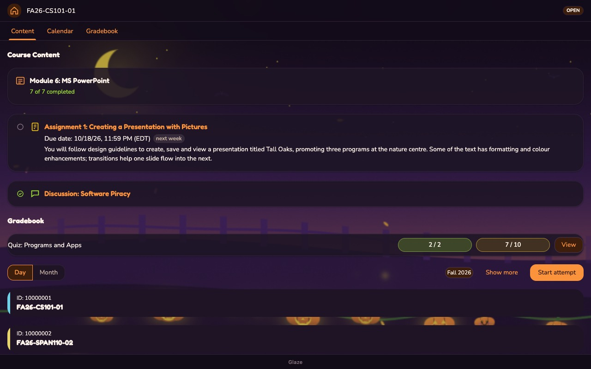
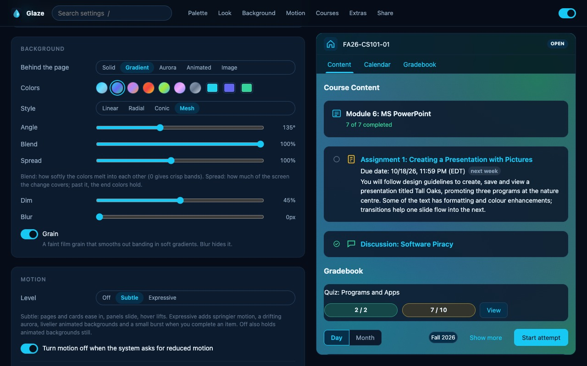

  <picture>
    <source media="(prefers-color-scheme: dark)" srcset="assets/logo-dark.svg">
    
  </picture>

<b>Make Blackboard Ultra, Canvas and Moodle feel like yours.</b>

  <a href="https://chromewebstore.google.com/detail/jmmaeoajomodnbnlmdikjooalmcilooh"><b>Get it for Chrome</b></a> ·
  <a href="https://github.com/frostdev-ops/glaze/releases/latest"><b>Download for Mac (Safari)</b></a> ·
  <a href="https://frostdev.io/glaze"><b>frostdev.io/glaze</b></a>

  

Glaze restyles your courses with palettes, fonts, backgrounds and motion, and adds tools for planning and studying right
where you do your coursework. It works at any school on Blackboard Ultra, Canvas or Moodle, including on a school's own
domain. No account, no analytics: what Glaze keeps stays on your device.

- **Your look:** palettes, fonts, frosted glass, gradients, animated scenes and video backgrounds, a color or Look per
  course, styled course cards, stickers and pointers. Share a Look as one line of text, or browse the free
  [Looks gallery](https://frostdev.io/glaze/looks).
- **Plan your week:** Better To Do with your own tasks and focus sessions, reminders, a class schedule read from your
  timetable, and calendar export or Google Calendar sync.
- **Know your grades:** what-if calculators that follow your course's own rules, a GPA with past terms, trends and a goal,
  and syllabus import.
- **Your dashboard:** widgets you place anywhere (notes, agenda, focus timer, music, your course cards), course tabs on
  Blackboard, and Ctrl/⌘K search across your courses.
- **Mods:** backgrounds, animations, widgets and page tweaks made by others, each showing what it reads and why before you
  add it, or build your own widget with no code.

<table>
  <tr>
    <td></td>
    <td></td>
  </tr>
  <tr>
    <td></td>
    <td></td>
  </tr>
</table>

## Install

- **Chrome, Edge, Brave:** from the [Chrome Web Store](https://chromewebstore.google.com/detail/jmmaeoajomodnbnlmdikjooalmcilooh).
- **Safari on Mac** (macOS 12+, Safari 17.2+): download the `.dmg` from the
  [latest release](https://github.com/frostdev-ops/glaze/releases/latest), open **Glaze**, click **Install Glaze**, then
  follow its guide to turn Glaze on in Safari's settings. It keeps itself up to date.
- **Firefox** (140+): not on Firefox Add-ons yet. Load a build as a
  [temporary add-on](docs/install.md#firefox).
- **iPhone and iPad, and loading from source:** see the [install guide](docs/install.md).

Then open your Blackboard Ultra, Canvas or Moodle site and click the Glaze icon.

## Built with AI, by a developer

I'm a software developer, and AI is one of my tools, not a substitute for knowing what I'm doing. Glaze is written with
AI assistance under my direction. I understand every line in this repository, whether I typed it or an AI wrote it for
me, and I take responsibility for all of it.

## Firefox

Firefox compatibility is maintained on the long-lived [`dev/firefox` branch](https://github.com/frostdev-ops/glaze/tree/dev/firefox),
which regularly merges `main`. Build Firefox releases from that branch; see [RELEASING.md](RELEASING.md).
Glaze needs Firefox 140 or newer on desktop, or Firefox 142 or newer on Android. Until it is listed on Firefox Add-ons, try it from a build:
run `sh scripts/package-firefox.sh`, open `about:debugging#/runtime/this-firefox`, click **Load Temporary
Add-on…** and pick `dist/glaze-v<version>-firefox.zip`. A temporary add-on is removed when Firefox quits.

For the dedicated Firefox for Android emulator, launcher and validation checklist, see
[Firefox for Android testing](docs/firefox-android.md).

To reproduce the vendored libraries, run `bash scripts/vendor-pdfjs.sh`, `bash scripts/vendor-three.sh` and
`bash scripts/vendor-lottie.sh` first (Bash, curl, tar, Node.js and npm are required).
The PDF.js script verifies the pinned 6.4.299 source archive, replaces its obsolete
global-discovery eval with `globalThis`, fixes imports to Glaze's bundled worker and
image decoders, and minifies with esbuild 0.28.2. These generated files are checked in;
normal packaging needs no npm install. Firefox packaging supplies an unavailable
Google sign-in adapter and requires Android 142 for its data-collection manifest key.

## More

[Docs](docs/README.md) · [Features](docs/features.md) · [Changelog](CHANGELOG.md) · [Privacy](PRIVACY.md) ·
[Contributing](CONTRIBUTING.md) · [Make a mod](docs/mods-api.md) ·
[Report a problem](https://github.com/frostdev-ops/glaze/issues)

MIT licensed, see [LICENSE](LICENSE). Blackboard is a trademark of Anthology Inc. This project is not affiliated with,
endorsed by, or sponsored by Anthology Inc.
