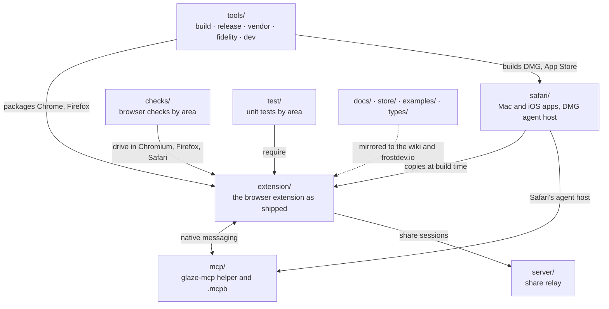
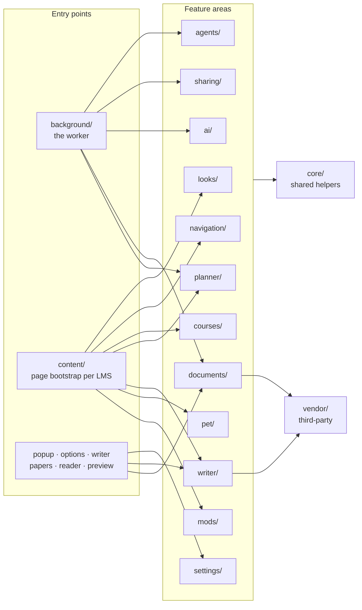

# Repository layout



```
glaze/
├── extension/      the store zip's contents; load unpacked from here
├── mcp/            the glaze-mcp helper (npm) and Claude Desktop bundle
├── safari/         Xcode project, the DMG's agent host
├── server/         share relay
├── checks/<area>/  browser checks (glaze-remote -- node checks/<area>/<name>-check.js /out), checks/mocks/
├── test/<area>/    unit tests (node --test), test/fixtures/, test/helpers/
├── tools/          build/, release/, vendor/, fidelity/, dev/
├── docs/  store/  examples/  types/
└── .github/        workflows, pins/
```

## Inside extension/

Each feature area holds its logic at the top, the code that runs on the school's page in `page/`, and its styles beside
them. Pages students reach by address stay at the root.



| Folder | What's in it |
|---|---|
| `background/` | the worker |
| `content/` | the content scripts per LMS, the page stylesheets, settings defaults |
| `core/` | helpers every area uses: colour, i18n, UI, zip, site, widgets host |
| `looks/` | Looks, Look parts, motion, animated backgrounds, fonts |
| `navigation/` | the nav bar, course tabs, sidebar, palette and search |
| `courses/` | Ultra, Canvas and Moodle course pages: cards, stream, announcements, folders, previews, rubrics |
| `planner/` | to-dos, reminders, schedule, calendar export, syllabus, grades, GPA, notes, imports |
| `writer/` | Glaze Writer; `writer/frame/` is `writer.html`'s code |
| `documents/` | Documents (`papers.html`), with `sheets/`, `pdf/` and `slides/` |
| `ai/` | the AI broker, providers and tasks |
| `agents/` | agent access (MCP): the native link, tools, approval window |
| `sharing/` | share sessions and quick share |
| `mods/` | mods: API, broker, sandbox host, widgets |
| `pet/` | the study buddy |
| `settings/` | the popup's and options page's code, the settings editor, welcome |
| `vendor/` | third-party code, moved byte for byte: pdf.js, Tesseract, Harper, three.js, ProseMirror, Lottie, paper fonts |
| `assets/`, `_locales/`, `i18n/`, `fonts/`, `icons/` | art, store strings, translations, bundled fonts, icons |
