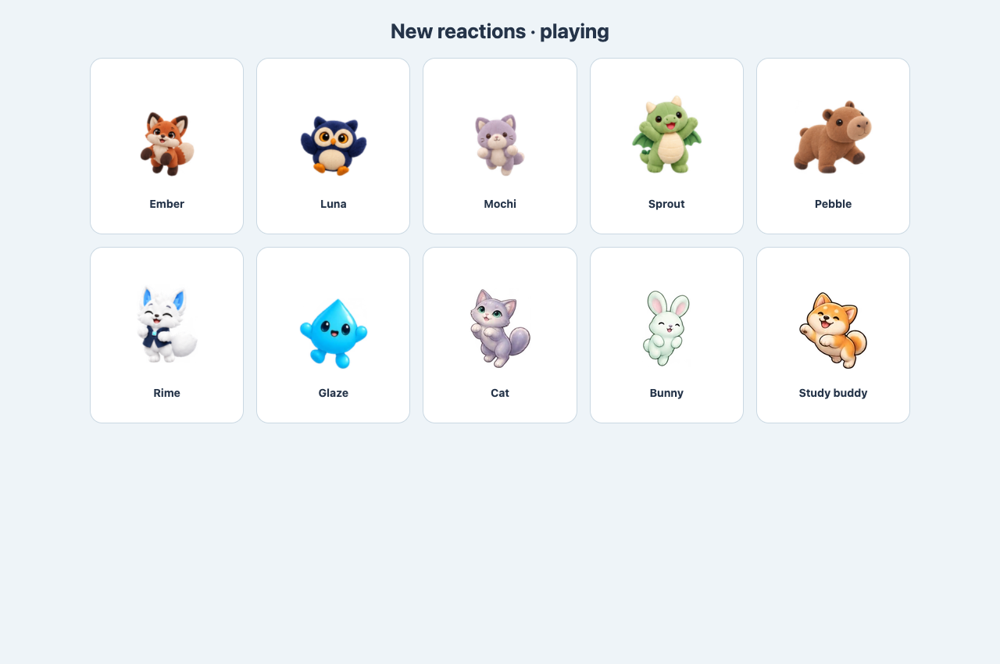
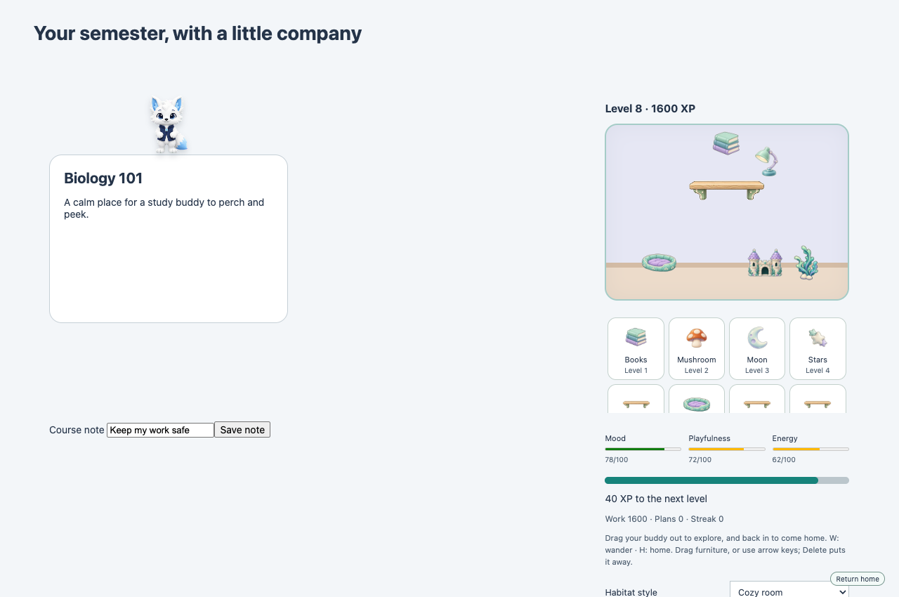
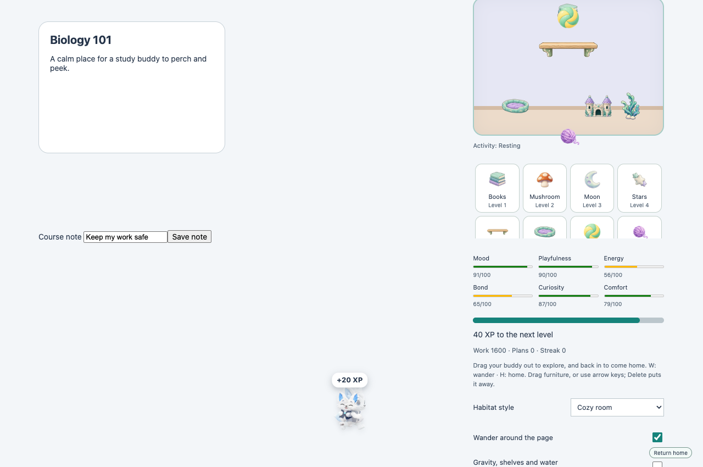
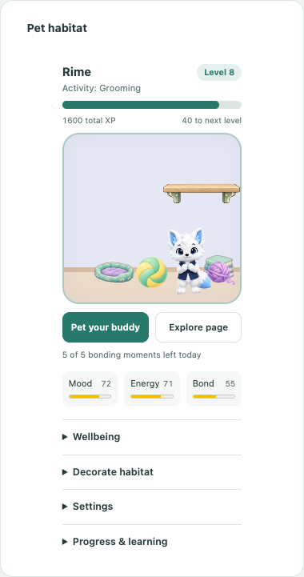

# Career-long pet habitats

Pet XP and equipment stay in the existing `pet:<school origin>/<student id>` record across courses and semesters. The original five level thresholds are unchanged. Later thresholds follow `600 + (level - 5) * 200 + (level - 5) * (level - 6) * 20`, with no final level. History holds up to 65,536 contribution records and 32,768 verified streak days; exceeding a bound preserves the stored record instead of resetting it.

Settings export/import now carries pet history, placements, needs and learned preferences. Import unions missing contributions and streak days, retains current settled contributions (including deliberate zeroes), and uses the existing rollback transaction. It compares feedback and observations to preserve the more-trained model, keeps the current model on a tie, and selects needs by their saved timestamp. Imported task completion and plan fields get a bounded baseline so they cannot undo or re-award settled XP; a later change to those fields resumes normal reconciliation. Imported custom character image packages remain in the separate pet library and need importing on a new device. Accounts are isolated; importing a backup does not automatically link different school identities.

## Habitat and wandering

The widget lays out by its tile's room, wherever the tile is: a board, floating, the sidebar dock or a phone. The habitat comes first and fills the tile's width at a pleasant aspect; the buddy's name, level and a thin XP bar sit on it, and its status shows while it is out exploring. Under it are Pet your buddy (with today's bonding moments on it; the full sentence is its description and tooltip), Explore page and ⋯, which opens the whole habitat in its dialog. Wider tiles add the Mood / Energy / Bond meters and a row of three panels, Wellbeing, Decorate and Progress, one open at a time; very wide tiles put the habitat beside them. The pet, furniture and toys scale with the habitat and keep their places when the tile is resized. Wellbeing shows the other needs; Decorate groups the habitat style, toys, available furniture, precise placement and upcoming unlocks. Clicking a supply adds it or puts it away. Settings (character, outfit, physics and learning) is in the dialog, and Progress contains XP and preference details. Open sections and keyboard focus survive updates. The dialog uses the same controls. It closes on Escape (as well as with Close) and returns focus to what opened it; where the pet's own Escape handling uses the key first, that wins.

The room, moss garden, water tank and cloud loft share the same furniture. Drag items from the tray into the habitat, then drag them freely. Arrow keys move a focused item, Shift moves farther, and Delete/Backspace puts it away. The dropdown controls provide a non-drag alternative. Keyboard focus survives repainting, furniture moves and toy transfers, and closing a habitat dialog restores the widget’s furniture. Three independently placed shelf pieces support pets and falling items. Gravity, collisions, wall response, water drag and buoyancy use bounded time steps without a physics dependency.

Drag the pet outside to enable wandering and inside to return home. W and H perform the same mode changes; Return home remains accessible while wandering. A wandering pet lives in page content coordinates, so window scrolling and native content panes carry its spot with the page. The pet and each dropped toy track their own scroll ancestors; unrelated sidebar or tray scrolling does not move them. It keeps its current action briefly, then an awake pet gently walks or climbs back toward a visible perch or resting spot after about three seconds offscreen. Sleeping pets stay where they settled. New perch choices and recovery targets fit the pet inside the visible viewport. Nested scrolling carries free, sleeping and perched pets, including with reduced motion; dropped toys also keep their page positions. A wandering pet survives closing its habitat window, follows the saved mode after page reload, and reacts to changes from another tab. Disabling the feature removes the companion. Hidden documents, offscreen habitats and reduced motion pause movement.

Wandering uses visible element geometry to approach cards/headings, climb edges, sit on top, and hide/peek behind cards. A mask occludes the part behind an element; page content and controls are never activated or edited. Perches track scrolling and disappear safely when their source element is removed. Forms, navigation, editable elements, assessments and tool pages are excluded.

Pets and dropped toys share page surfaces: footers, course cards, widgets, module rows, panels, headings, figures and tables. The Glaze footer is a walkable floor, with the companion layer above the footer so pets and toys stay visible. Fixed footer supports follow the viewport when the document scrolls; pets never choose a footer for hiding. Surface scans prioritize the current viewport and occupied supports on long pages, cache ancestor styles within each bounded scan, and exclude hidden or clipped ledges. A scroller's outside edge stays still while its own contents scroll. Nested content, active course frames, resizing and removed supports retain their own geometry and scroll anchors.

Blackboard's live course tabs share the same top-level companion. The active course frame supplies its surfaces, pointer activity and scrolling only after its current document confirms the same school account. Switching tabs detaches the previous frame's listeners; hidden frames have no separate pet. Loading, unconfirmed, external and assessment frames are excluded.

## Local learning and needs

`lib/petbrain.js` is a versioned online contextual bandit with twelve activities and twenty-six bounded numeric features. It combines contextual tanh predictions, diagonal confidence estimates, faster and slower reward averages, six time-of-day buckets and a bounded action-transition matrix. Recent-action fatigue limits repetition without forcing a settled pet to move. The old five-action/twelve-feature model migrates by preserving its existing weights and counts.

Petting/play and moved-away/recall feedback train the current activity and up to three preceding decisions, with exponentially decaying credit over sixty seconds. Long settled activities still receive direct feedback using their current target context. Traces are consumed once; future/backward/replayed timestamps are ignored. Observations are limited to one every eight seconds across tabs. Toy features distinguish the ball from yarn; autonomous play ranks available toys using those learned preferences. Focus/break transitions, furniture changes and actual XP gains also affect needs and behavior; the serialized broker applies each shared timer transition or reconciled XP gain once across tabs, including timer expiry followed by timer advancement; no pet interaction changes academic XP.

The policy normally finds a comfortable spot and stays there: perching, study, rest and grooming last 45–120 seconds. Ordinary walks are brief. Typing, scrolling and focus discourage active behavior; following and autonomous play need a recent invitation. The pet can investigate furniture, study beside books or a heading, groom, stretch, follow the pointer at a distance and return to a visible habitat voluntarily. Recalled and voluntary returns receive different feedback. Geometry scans are throttled during scrolling and pause with reduced motion or an ineligible world. Geometry changes keep perches aligned; movement eases into its destination. A settled pet watches nearby cursor movement without leaving its spot, then returns to its idle pose. Buddy, navigation and course-card displays also follow the cursor with their available gaze poses; reactions keep priority and reduced motion remains still.

Petting and direct play feedback share five bonding moments per school account each day, with at least one minute between accepted moments. The background broker applies the limit to both needs and learning feedback, across widgets, page companions, keyboard interaction, tabs and reloads. Only accepted moments trigger click reactions or cheers; held keys and rapid clicks cannot stack them. The saved allowance resets at midnight in its saved account time zone. Learning reset and restoring an older backup preserve spent moments and the latest cooldown. Existing progress and bond are retained, and time away still gently returns needs toward comfortable baselines.

Walking poses follow actual horizontal movement, including approach paths, toy chasing, perch settling and direction changes at walls. A travelling pet keeps its walking pose rather than turning to watch the cursor; classic and older card sprites mirror leftward walking.

Mood, playfulness, energy, bond, curiosity and comfort appear as 0–100 meters. Interactions adjust them, while time away gently returns values toward comfortable baselines rather than punishing absence. The learning panel shows familiarity, a preferred activity and a learned time preference. Turning learning off stops use/update of the model and clears pending credit; Reset learned behavior clears the model without changing XP, equipment or needs. Everything stays in the account's local pet record and chosen backup. No typed text or page content is training data.

### Toys

The level-one Toy ball and Yarn ball can be placed from the furniture tray. Drag either toy out of the habitat and drop it on the page to invite the pet out for a fifteen-second play session, followed by a quiet rest. A recent scroll does not cancel that explicit invitation; typing still takes priority. Recently invited autonomous play also chooses among reachable toys for fifteen seconds, then rests; focus and scrolling still interrupt autonomous play. Toys roll/bounce gently and can be dragged again. Drag a toy back into the habitat to put it back. A focused toy also supports W to take it out, H to return it, arrow keys to move it, and Delete to put it away. Floating toy positions are temporary; saved habitat positions survive reloads. Disabling the companion removes toys and all other owned overlays.

Dropped toys land on page ledges, rebound from panel sides and undersides, and rotate as they roll. Drops near a ledge settle on its top even when the pet or toy slightly overlaps the edge on release. The ball bounces more than yarn. Settled toys follow their supporting element through layout changes and nested scrolling, and fall again if the support disappears. Their page collisions remain active while the pet is home. During an invitation, the pet can approach and climb a reachable raised toy support; kicks require the pet to be close horizontally and vertically. Reduced motion keeps toys still while preserving supported placement during scrolling and layout updates.

The model is a local preference learner. It uses no language model, server or network service. See [pet-animation-api.md](pet-animation-api.md) for renderer and learning hooks.

## Local validation

The existing 2,123-test Node suite passes. Temporary assertions cover learned preference reversals across time/mode contexts, malformed/sparse input rejection, persisted interaction feedback, learning disabled/reset, independent academic XP, older-backup merging, rollback and career thresholds. Headless Chromium checks on controlled local school fixtures cover native item/pet dragging, keyboard placement, water, climbing, perching and scroll tracking, hide/peek masking, fold/unfold wake, cross-tab activation, reduced motion and cleanup. Long-page checks cover nonzero scroll with a positioned/margined body, sleeping and perched document positions, bounded recovery through repeated scrolling, nested scrollers on non-dashboard Canvas/Ultra routes, free/sleeping/perched pets and toys, horizontal scroll, scroll-back and unrelated sidebar isolation, exact pet/toy drag anchors and owned-layer cleanup. Expanded assertions cover calm durations, all new activity loops, toy play/return, capture after reparenting and release outside the viewport, disabled toy physics, focus/typing, long-settled feedback, model migration and toy-preference reversal, XP undo/re-earn reactions, cursor gaze and the shared renderer. Timeline assertions cover 30 fps active blending, one-shot returns, rapid state changes and clock/resource cleanup. All ten delivered atlases play all six new states with distinct rendered pixels and no browser errors. The existing real-extension board checks also pass (42 Canvas checks and 185 Blackboard checks), including wide/mobile layouts and no page errors. Surface checks also cover footer stacking and fixed positioning, pet/toy landing, panel side and underside collisions, moving and removed supports, raised-toy climbing, toy collisions while the pet is home, and reduced-motion scroll anchoring. Care checks cover a 200-click queued burst, the shared pet/play daily allowance, midnight and cooldown boundaries, timezone fallback, rollback, backup and learning-reset preservation, and failed-write retries. Widget checks cover add/put-away controls, disclosure persistence, shared click/keyboard limits, light/dark 375/320px layouts and cleanup. Movement checks cover reversals, target approaches, perch settling and classic/card sprite mirroring. These checks do not establish authenticated LMS or Safari runtime verification, deployment or publication.

